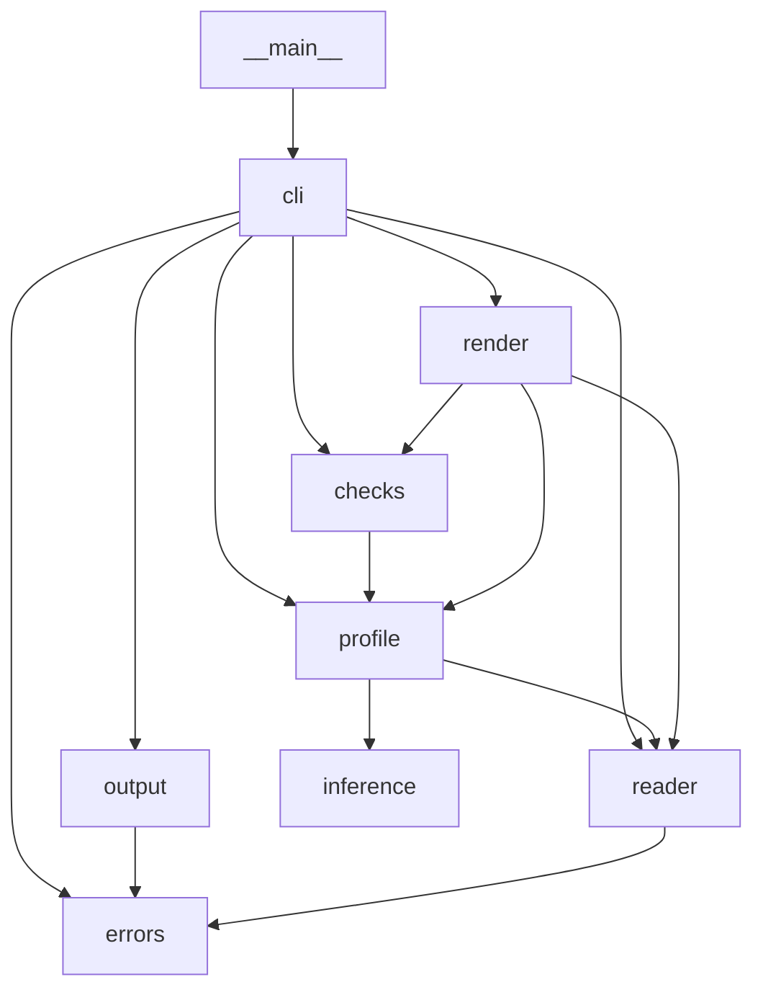

# csv-quality-report

[](https://github.com/rodrix91/csv-quality-report/actions/workflows/ci.yml)


> **Status: prototype/alpha.** Maintained by [rodrix91](https://github.com/rodrix91). Interfaces and output formats may change without notice.

A small command-line tool that gives a quick data-quality check of a CSV file before you use it.

## Problem and scope

Before loading a CSV into a notebook or pipeline, analysts and engineers usually want a fast answer to: *what types are these columns, how much is missing, are there duplicate rows, and what do the values look like?* `csv-quality-report` answers that for one local file with one command.

Per column it reports:

- inferred type (`int`, `float`, `bool`, `date`, `datetime`, `string`)
- missing count and percentage
- distinct count (non-missing values)
- min / max (numeric and date columns)
- top 3 most frequent values (configurable with `--top`)

At dataset level it reports the row count and the number of duplicate rows.

Out of scope: automatic data cleaning, centralized schema-registry management, automatic encoding detection (other encodings are read when named with `--encoding`), and network sources. The CLI does support local schema-oriented gates such as required columns and types, allowed type changes, and baseline schema-change checks.

## Requirements

- Python 3.11 or newer
- Runtime dependencies: **none** (standard library only)
- Development: `pytest`, `ruff`, `mypy`, `build` (pinned in `requirements-dev.txt`; full pins with hashes in `requirements-dev.lock`)

## Install

From a clone of this repository:

```bash
python3 -m venv .venv
. .venv/bin/activate
pip install --require-hashes -r requirements-dev.lock   # exact pins with hashes (alternative: -r requirements-dev.txt)
pip install -e .
```

You can also run the tool without installing it: `PYTHONPATH=src python3 -m csv_quality_report FILE`. Installing the package (`pip install -e .`) is only needed for the `csv-quality-report` command or for using it from other environments; the test suite does **not** require it.

## Verify release artifacts

Releases produced by the current release workflow include a `SHA256SUMS` file and GitHub artifact provenance attestations for the wheel and source distribution. After downloading the release files into one directory, verify the checksums:

```bash
sha256sum -c SHA256SUMS
```

Then verify provenance for each artifact with GitHub CLI:

```bash
gh attestation verify PATH/TO/ARTIFACT -R rodrix91/csv-quality-report
```

Historical releases created from older commits may predate checksums or provenance attestations; verify only the guarantees actually published with that release.

## Usage

```text
python -m csv_quality_report PATH [--format markdown|json] [--json-output FILE] [--record-time] [--max-rows N] [--columns NAMES] [--top N]
                             [--delimiter CHAR] [--skip-lines N] [--skip-footer N] [--encoding NAME] [--max-field-size N] [--na TOKENS]
                             [--decimal-comma] [--thousands SEP] [--date-order dmy|mdy|ymd [--month-names]] [--bool-words TRUE,FALSE ...]
                             [--number-affix TEXT ...] [--accounting-negatives]
                             [--max-missing PCT] [--max-missing-column NAME=PCT ...] [--max-duplicates N] [--min-rows N]
                             [--require-columns NAMES] [--require-type NAME=TYPE ...] [--max-affixes NAME=N ...]
                             [--range NAME=MIN:MAX ...] [--unique NAME ...] [--unique-key NAMES ...] [--allowed-values NAME=VALUES ...]
                             [--pattern NAME=REGEX ...]
                             [--max-age NAME=DURATION ... [--utc-offset OFFSET]]
                             [--baseline REPORT [--fail-on-schema-change [--allow-type-change [NAME=]FROM:TO ...]
                                                                         [--allow-added-column NAME ...] [--allow-removed-column NAME ...]]
                                                [--max-row-drop PCT] [--max-missing-increase PCT]
                                                [--max-missing-increase-column NAME=PCT ...] [--max-baseline-age DURATION]
                                                [--check-baseline-missing-rate]]
python -m csv_quality_report --version
python -m csv_quality_report --help
```

The first lines are reading and output options; the rest are the quality gates described in [Quality gates for pipelines](#quality-gates-for-pipelines), which exit with code 8 when a check fails. The gates nested under `--baseline` compare the run with an earlier report and need `--baseline` (without it they are a usage error, exit code 2). `...` marks a repeatable option. `--help` prints every option with a one-line description.

- `PATH` — the CSV file. Use `-` to read standard input. Gzip-compressed input (`.csv.gz`, or a compressed pipe) is detected from its first bytes and decompressed while streaming; no flag is needed.
- `--format` — `markdown` (default) or `json`.
- `--max-rows N` — analyze only the first `N` data rows (`N >= 1`). The output says when it stopped early (`truncated` in JSON).
- `--delimiter CHAR` — field separator (default `,`). Accepts one character, the aliases `tab`, `comma`, `semicolon` and `pipe`, or `auto` (see below). Use `--delimiter ";"` for files exported from spreadsheets with a Spanish, Portuguese or other comma-decimal locale. Decimal commas (`10,5`) are only parsed as numbers with `--decimal-comma`.
- `--delimiter auto` — detect the separator among `,` `;` tab and `|`. A candidate is accepted only if it gives the same number of fields (more than one) on every one of the first 100 lines (within 64 KiB); quoted fields are respected. If exactly one candidate fits, it is used; a file where every candidate gives one field is treated as a one-column file; otherwise the tool stops with exit code 7 instead of guessing. The chosen delimiter is shown in the report.
- **Excel's `sep=` line**: a first line such as `sep=;` (written by Excel and by tools that target it, sometimes in quotes or after a BOM) declares the separator. It is skipped, not taken as the header. With `--delimiter auto` the declared character is used without sampling; an explicit `--delimiter` must match it, and any other delimiter, including the default comma, stops with exit code 7 and names the declared one (`declares the semicolon delimiter in its first line (sep=;) ...; pass --delimiter auto to follow the file`) instead of producing a one-column report. Error line numbers still count the skipped line. JSON reports `sep_line`; Markdown says `Delimiter: semicolon (declared by a sep= line)`.
- `--skip-lines N` — skip the first `N` lines of the file before the header, for ERP and spreadsheet exports that start with title lines (`Reporte de ventas por sucursal`, `Generado: 22/10/2026 08:00`, a blank line). They are text lines, not CSV records, so an unbalanced quote in a title does not matter; they are counted after decoding, so `--encoding`, gzip and standard input work as usual. A `sep=` first line is still recognized and is not counted in `N`. `--delimiter auto` samples the lines after the skipped ones, and error line numbers still count them. A file that ends before a header is found stops with exit code 5 (`has no header row: it ends within the 3 lines skipped by --skip-lines`). Without the option, the two usual symptoms of title lines suggest the count: a one-field header followed by a wider row fails as a ragged row with `...expected 1 (from the header); if this row is the header and the lines before it are titles, skip them with --skip-lines 3`, and a failed `--delimiter auto` adds `if the file starts with 2 title lines before the header, skip them with --skip-lines 2` when dropping up to 20 leading lines without separators lets one separator fit every remaining line. JSON reports `skipped_lines` and Markdown says `Skipped lines: 3 (before the header)`, only when `N > 0`, so reports without the option are unchanged.
- `--skip-footer N` — drop the last `N` records of the file, for ERP and spreadsheet exports that end with a footer after the data: a totals row (`Total general;;2.214,50`), a record count (`Cantidad de registros: 2`), a "generated by" line. Without it a one-field footer fails as a ragged row (exit code 6) or makes `--delimiter auto` fail (exit code 7), and a totals row of the header's width is profiled as data, so it turns a date column into `string`, moves the maximum and the mean, and can fail `--range`, `--unique` or `--pattern`. The footer is counted in CSV records after the header, so blank lines are not counted (an empty-cells row such as `;;` is a record, an empty line is not), and footer records are never checked against the header's width. The file is still read once: each row is held until `N` more have been read, so the extra memory is `N` rows. `--max-rows` still counts data rows. A file with fewer than `N` records after the header stops with exit code 5 (`has 2 records after the header, fewer than the 3 skipped by --skip-footer`). With `--delimiter auto`, when the file fits in the detection sample (64 KiB), its last `N` non-blank lines are left out of the sample. Without the option, the two usual symptoms of a footer suggest the count: a ragged row among the last 20 records whose following records are all ragged too adds `if this last record is a footer, skip it with --skip-footer 1 (add one for each totals row above it)`, and a failed `--delimiter auto` on a file that fits in the sample adds `if the file ends with 1 footer line after the data, skip it with --skip-footer 1` when dropping up to 20 trailing lines lets one separator fit every remaining line. A totals row has the header's width, so no message can point at it: count it in `N`. Combine it with `--skip-lines` for exports with titles and a footer. JSON reports `skipped_footer` and Markdown says `Skipped footer: 2 records (after the data)`, only when `N > 0`, so reports without the option are unchanged.
- `--decimal-comma` — read floats written with a comma as decimal mark (`10,5`, `-0,25`). With the flag, values written with `.` are no longer floats, thousands separators (`1.234,5`) are recognized only with `--thousands`, and `1,234` means 1.234. Top values keep the original text; min/max are reported as numbers.
- `--encoding NAME` — text encoding of the file: any Python text codec, such as `cp1252`, `latin-1` or `utf-16` (default `utf-8`, with an optional BOM). Works with standard input, gzip and `--delimiter auto`. Unknown names and non-text codecs (`base64`) are usage errors; bytes that are invalid in the chosen encoding stop with exit code 4 and their offset. JSON reports the canonical name as `encoding`; Markdown adds an `Encoding:` line when it is not UTF-8.
- `--max-field-size N` — allow fields of up to `N` characters. Python's `csv` module stops at 131,072 by default, which also protects against an unclosed quote swallowing the rest of a file into one field, so the default is kept; a file that hits it stops with exit code 6 and a message that names this option. The limit is restored after the run (it is process-wide in the `csv` module).
- `--json-output FILE` — also write the JSON report (the same content as `--format json`, including `checks`) to `FILE`, while stdout keeps the chosen `--format`. The data is profiled once. The file is written even when a quality gate fails, so CI can keep it as an artifact; reading errors write no file, and a file that cannot be written stops with exit code 9.
  - Atomic write: the report is written to a temporary file in the same directory and then moved onto `FILE` (`os.replace`), so a failure or an interrupt never leaves a half-written report and never destroys the one an earlier run left there (often the next run's `--baseline`); the temporary file is removed and the tool exits with code 9. An existing `FILE` keeps its permissions, a read-only `FILE` is refused and kept (`cannot write 'FILE': the file is read-only`, on every platform), a symbolic link is written through, and a target that is not a regular file (`/dev/stdout`) is written in place. The directory must be writable; a hard-linked `FILE` becomes a new file. See [ADR 0004](https://github.com/rodrix91/csv-quality-report/blob/main/docs/decisions/0004-atomic-output.md).
  - Protection: a `FILE` that is the input file or the `--baseline` report (also through another spelling of the path, a symbolic link or a hard link) is a usage error (exit code 2), checked before reading, so the report never overwrites its own data.
- `--record-time` — add the UTC time the run started to the JSON report, as a top-level `"generated_at": "2026-10-16T04:06:00Z"` right after `source` (whole seconds, always with `Z`), in the report on stdout with `--format json` and in the `--json-output` file. A later run that uses the report as its `--baseline` can then check its age with `--max-baseline-age`. Without the option no time is written, so the same input gives the same bytes on every run, which golden files and report diffs rely on. When the environment variable [`SOURCE_DATE_EPOCH`](https://reproducible-builds.org/specs/source-date-epoch/) is set (seconds since 1970-01-01 UTC), it replaces the clock, for the stamp and for `--max-baseline-age`, so both can be reproduced exactly; a value that is not a whole number is a usage error (exit code 2). Markdown has no stamp, so the option needs `--format json` or `--json-output` (otherwise a usage error). See [ADR 0008](https://github.com/rodrix91/csv-quality-report/blob/main/docs/decisions/0008-report-timestamps.md).
- `--top N` — how many most frequent values to list per column (default 3; `0` lists none). JSON reports the setting as `top_n`.
- `--columns NAMES` — profile only these comma-separated columns, in the order given (repeated names count once; blank comma-separated positions are rejected with exit code 2 rather than silently skipping a column); useful for wide ERP or BI exports where a pipeline only cares about a few columns (on a 200,000-row file with 40 columns, profiling 3 of them takes about 2.0 s instead of 3.0 s; reading and comparing whole rows is the part that remains). Rows are still read whole, so ragged rows and encoding errors are still found and duplicate rows still compare full rows; `--require-columns` checks the full header. A name that is not in the header is a usage error (exit code 2) that lists the columns and suggests a name that only differs by surrounding whitespace; a per-column gate on a column left out is a usage error too. JSON reports `selected_columns` (`null` by default) and `header_columns`; Markdown says `Columns: 3 of 40 (selected)`.
- `--baseline REPORT` — compare the run with an earlier JSON report of the same source (written with `--format json` or `--json-output`), to see what changed in a scheduled export: columns added and removed, type changes (`Monto float -> string`), missing-value changes per column (`Peso 12.5% -> 44.4%`) and the row count. Markdown adds a `## Changes since baseline` section; JSON a `baseline` object (`null` without the option). Columns are matched by name; with `--columns`, only the selected ones are compared, so use the same reading options as for the baseline. A baseline that cannot be read or is not a report of this tool stops with exit code 3. For reliable drift detection, baseline row counts must be non-negative; column names must be unique (compared exactly, respecting case); and each column's missing percentage must be a finite number from 0 to 100. Invalid metadata is rejected before analyzing the input (exit 3), rather than silently overwriting duplicate labels or accepting impossible missingness. A column's non-negative integer `missing` count, when present, also cannot exceed the baseline's total row count; otherwise the baseline is rejected as internally impossible. Older reports without an exact integer `missing` count remain loadable; their count-dependent drift gates separately flag the missing count.
- `--check-baseline-missing-rate` — optional strict audit with `--baseline`. When a prior report includes a valid nonnegative integer `missing` count for a column, verify that its `missing_pct` agrees with `100 × missing / rows` within **0.05 percentage points**, the one-decimal reporting precision (plus a tiny floating-point tolerance). Reject inconsistent baseline counts/percentages before opening the new CSV (exit 3). An absent or invalid-type legacy count remains unavailable rather than inferred; without this option, historic permissive behavior remains unchanged. A zero-row report must have 0% missing for any zero-count column. Example: `--baseline previous.json --check-baseline-missing-rate --max-missing-increase 5`.
- `--thousands SEP` — thousands separator in numbers: `dot` (`1.234,56`, needs `--decimal-comma`), `comma` (`1,234.56`) or `space` (`1 234,56`, also no-break spaces). A separator is removed only from a correctly grouped number (a first group of 1 to 3 digits, then groups of exactly 3), so `1.23` or `12.34.56` are not taken as thousands; such values then show up in the column's `type_hint`. Type, range and mean use the numbers without separators; top values and text lengths keep the text as written. A separator that is also the decimal mark is a usage error. JSON reports `thousands`; Markdown adds a `Thousands separator:` line.
- `--date-order dmy|mdy|ymd` — read non-ISO dates in the given order: day/month/year (`05/10/2026` is 5 October), month/day/year (`10/05/2026`) or year/month/day (`2026/10/05`). Day and month take one or two digits and the year four (two-digit years are not accepted, since the century would be a guess); the separator is `/`, `-` or `.`, the same one twice; an optional time `H:MM` or `HH:MM:SS` may follow after a space or `T`, also on the 12-hour clock with `AM`/`PM` in any case, with or without dots and spaces (`2:30 PM`, `2:30pm`, `2:30 p.m.`, the Spanish `2:30 p. m.` with no-break spaces); a 12-hour time needs an hour from 1 to 12 and is read as 24-hour (`12 AM` is 00). The order is never guessed: `05/10/2026` reads differently in each order, and a column where every day is at most 12 gives no clue. Matching values are read as ISO 8601, so the column becomes `date` or `datetime`, ISO values keep working alongside, and impossible dates (`31/02/2026`) stay text and appear in the `type_hint` as written. Min and max are reported in ISO 8601 (`2026-10-05`); top values and text lengths keep the text as written. JSON reports `date_order`; Markdown adds a `Date order:` line.
- `--month-names` (with `--date-order`) — also read dates whose month is written as a word, as Excel's `dd-mmm-aaaa` format and many ERPs export them: `05-oct-2026`, `05-oct.-2026`, `5/Octubre/2026` and `05-set-2026 14:30` with `dmy`, `Oct-05-2026` with `mdy`, `2026-oct-05` with `ymd`. Spanish and English month names and abbreviations are read in any case, also `sept`, and `set` / `setiembre` as written in Peru and Uruguay (the abbreviations of the two languages never name different months, so no language needs to be chosen). An abbreviation may end with a dot (`oct.`), except when the date separator is itself a dot; a full name may not. Separators, years and times follow `--date-order`; two-digit years (`05-oct-26`) and long forms (`5 de octubre de 2026`) are not read. A word that is not a month (`05-ott-2026`) leaves the value as written, so it appears in the `type_hint` like any unreadable date. Without the option, reports are unchanged; with it, JSON adds `"month_names": true` and Markdown a `Month names:` line.
- `--bool-words TRUE,FALSE` — also read these words as booleans, in any case (`casefold`), like `true`/`false`, which always count; repeatable: `--bool-words sí,no --bool-words verdadero,falso` (Spanish Excel writes logical values as `VERDADERO`/`FALSO`). Accents are not removed, so `si` and `sí` are different words and can both be given. Words are never assumed (`no` is also ordinary text). A pair with equal words, a word that is true in one pair and false in another, or a word that is already a number or a date (`1,0`, which would turn quantity columns into text; 0/1 columns are `int`) is a usage error. Only whole values match; a stray value shows up in the `type_hint` as written, top values and text lengths keep the text as written, and `--na` tokens are removed first. JSON reports `bool_words` (a list of pairs); Markdown adds a `Boolean words (true/false):` line.
- `--number-affix TEXT` — text allowed before or after numbers, such as a currency symbol, a unit or a percent sign; repeatable: `--number-affix '$' --number-affix 'Gs.' --number-affix kg --number-affix %`. The affix is removed (case-sensitive, with the spaces next to it, also no-break spaces) only when what remains is a number under `--decimal-comma` and `--thousands`, so `$ 1.234,56`, `US$ 15`, `12,5 kg` and `15 %` become numbers while `$ consultar` stays text and shows up in the `type_hint`. A sign may come before a prefix (`-$ 5` is -5). Numbers are not scaled (`15 %` is 15). Each column reports how many cells had each affix: `affixes` in JSON (`{"Gs.": 6, "US$": 2}`, `{}` by default) and a `Number affixes:` Markdown line, so a column that mixes currencies or units (`kg` and `lb`) is visible instead of being silently averaged. An empty affix, one made only of signs and separators, or one that is a number is a usage error. JSON reports the given texts in `number_affixes`.
- `--accounting-negatives` — read the negative forms of accounting and ERP exports: parentheses (`(1.234,56)`, Excel's accounting format) and a trailing minus (`1.234,56-`, as SAP and other ERPs write it) become `-1.234,56`. It combines with the other options: affixes inside the parentheses or before them (`($ 5)`, `$ (5)`), decimal commas and thousands separators. A value is rewritten only when the result is a number; `(-5)`, `(5`, `5--` or `(ver anexo)` stay as written (and appear in the `type_hint` when they block a type). JSON reports `accounting_negatives`; Markdown adds an `Accounting negatives:` line.
- `--na TOKENS` — comma-separated cell values to count as missing, in addition to empty cells, e.g. `--na NA,null,s/d`. Matching is exact and case-sensitive after stripping spaces. A token list that starts with `-` must be attached with `=`: `--na=-,NA`. Missing tokens are excluded from type inference, distinct counts and top values, so a quantity column with `NA` gaps is still reported as `int`. Duplicate-row detection keeps comparing the raw text.

### Pipes and compressed files

The input is streamed, so it can come straight from another command, compressed or not:

```bash
gunzip -c shipments.csv.gz | python -m csv_quality_report - --delimiter auto
python -m csv_quality_report shipments.csv.gz --format json     # decompressed on the fly
curl -s https://example.org/export.csv | python -m csv_quality_report - --max-duplicates 0
```

On standard input the report names the source `<stdin>`. `--delimiter auto` works on pipes too: it reads its sample, completes the current line and keeps reading the same stream, without seeking. Two limits come with pipes: a non-UTF-8 byte cannot be located by re-reading, so the error says the offset is not available; and corrupt or truncated gzip data stops with exit code 3. For gzip files on disk, the offset of an invalid byte is counted in the decompressed data.

### Quality gates for pipelines

By default the tool only reports. With thresholds it also decides: the full report is still printed to stdout, every failed check is printed to stderr as `check failed: ...`, and the exit code is **8** when at least one check fails (0 when all pass). A value equal to its limit passes.

- `--max-missing PCT` — fail if any column has more than `PCT` % missing values (0 to 100). The comparison uses the exact percentage, not the rounded `missing_pct` shown in the table.
- `--max-missing-column NAME=PCT` — a missing-value limit for one column, overriding `--max-missing` for it; repeat the option for several columns, and use it with or without `--max-missing` (for example, `--max-missing 5 --max-missing-column comment=100 --max-missing-column shipment_id=0`). The name is exact and case-sensitive and is split from the value at the last `=`; if a name is given twice, the last limit wins. A limit for a column that is not in the header fails as a `required_column` check instead of being ignored, since it usually means a typo or a renamed column.
- `--max-duplicates N` — fail if the file has more than `N` duplicate rows (`0`: none allowed).
- `--min-rows N`: fail if the file has fewer than `N` data rows (`Rows analyzed`, at least 1), for an export that arrived with only its header, as ERP jobs that fail half-way and queries with a wrong filter often leave. Such a file passes every other gate, since nothing in it is missing, repeated or out of range: `the file has 0 data rows (at least 1 required)`. Unlike `--max-row-drop`, it needs no `--baseline`, so it also covers the first run of a pipeline. With `--max-rows M`, a file that has more rows counts `M`, so `N` above `M` is a usage error (it could never pass). File-level `min_rows` check in JSON, `value` the rows.
- `--require-type NAME=TYPE` — fail unless column `NAME` has type `TYPE` (`int`, `float`, `bool`, `date`, `datetime` or `string`); repeatable, the last type for a name wins. A column satisfies the type when it can be used as it: `int` columns satisfy `float`, `date` columns satisfy `datetime`, and every column satisfies `string`. A column with no values passes (use `--max-missing-column NAME=0` to require values). When a string column fails and its `type_hint` fits the required type, the message names the stray values: `column 'qty' is string, expected int (3 values do not fit: "N/A", "12a")`. An unknown column fails as `required_column`. JSON items of this check also carry `expected` and `actual`.
- `--max-affixes NAME=N` — fail unless column `NAME` contains at most `N` distinct `--number-affix` texts; repeatable, the last limit for a name wins. `NAME=1` stops a column that mixes currencies or units: `column 'Monto' mixes 2 number affixes: "Gs." in 6 cells, "US$" in 2 cells (limit 1)`. Plain numbers without an affix do not count. JSON items of this check also carry `found` (cells per affix). It needs `--number-affix` (without it no affix could be found and the check would always pass, so that is a usage error). An unknown column fails as `required_column`.
- `--range NAME=MIN:MAX` — fail unless every value of column `NAME` lies within `MIN..MAX`, inclusive; repeatable, the last range for a name wins. Either side may be left out (`Peso=0:`, `Cantidad=:5000`). Bounds are numbers for `int` and `float` columns; `YYYY-MM-DD` dates for `date` and `datetime` columns, which compare calendar days (`Escaneo=2026-10-01:2026-10-31` takes all of 31 October); or ISO 8601 date-times for `date` and `datetime` columns, in the forms type inference accepts (`Escaneo=2026-10-01T08:00:2026-10-01T18:00`, also with a space, seconds, `Z` or an offset; a date counts as midnight). Both bounds must be of the same kind, two date-times must both have a UTC offset or both lack one, and MIN must not be greater than MAX, or it is a usage error; the colon that separates MIN and MAX is the one between two bounds, so the colons inside times need no escaping. The check compares the column's min and max: `column 'Peso' has values outside 0..1000 (min -1, max 800)`. A column of another type fails and says so, naming the stray values when its `type_hint` fits (`column 'qty' is string, a range needs int or float values (1 value does not fit: "12a")`). Times are never placed in a guessed time zone: values with an offset are compared as instants against date-time bounds with an offset, and the check fails and says why when the column has offsets and the bounds do not (date bounds included, since the day of `23:30-05:00` depends on the zone), when the bounds have offsets and the column does not, or when the column mixes both and so has no range (see [ADR 0003](https://github.com/rodrix91/csv-quality-report/blob/main/docs/decisions/0003-datetime-ranges.md)). A column with no values passes. JSON items of this check also carry `range` and `observed` (`null` for an open side). An unknown column fails as `required_column`.
- `--unique NAME`: fail when column `NAME` has a non-missing value more than once, for key columns such as an invoice number, a tracking code or a SKU in a price list; repeatable. This catches what `--max-duplicates` cannot: rows that share a key but differ elsewhere (a re-sent parcel, a second line with another amount). Values compare as the report counts them: stripped of surrounding whitespace (`" AR-1007 "` repeats `AR-1007`), case-sensitive and as text, so `007` and `7` are different keys. Missing cells (empty or `--na`) never repeat; add `--max-missing-column NAME=0` to also require a key in every row. The message gives the number of cells that repeat an earlier value, which is exact, and names the most repeated values from the column's top values: `column 'Guía' is not unique: 3 cells repeat an earlier value ("AR-1004" in 3 cells, "AR-1007" in 2 cells)` (with `--top 0`, the count alone). The whole argument is the name, so it may contain commas or `=`. It costs nothing extra: each column already counts its distinct values in the single pass. JSON items of this check have `value` (the repeated cells), `limit` 0 and `repeated` (cells per listed value). An unknown column fails as `required_column`; with `--columns`, naming a column that is left out is a usage error.
- `--unique-key NAMES`: fail when two rows share the values of all the comma-separated columns `NAMES`, for keys made of several columns, such as invoice number and line number, branch and document number, or order and SKU, where each column repeats on its own and `--unique` cannot be used; repeatable, one check per key. Empty comma-separated key components (for example `Factura,,Línea`, leading/trailing commas or whitespace-only positions) are rejected as usage errors (exit 2) rather than silently omitted. Key cells compare like `--unique` values: stripped of surrounding whitespace, case-sensitive and as text. A row with a missing cell (empty or `--na`) in any key column is skipped, not checked, and counted: add `--max-missing-column NAME=0` for each key column to also require them. The message gives the exact number of rows that repeat an earlier row's key and the first keys found repeated, with their rows: `key 'Sucursal' + 'Factura' + 'Línea' is not unique: 1 row repeats an earlier key ("CBA" + "0001-00000102" + "1" in 2 rows); 1 row with a missing key cell was skipped`. At most `--top` keys are listed (none with `--top 0`), in the order they were found repeated, so they are a sample, not necessarily the most repeated ones. Names are split at every comma and stripped, as in `--require-columns`, and a repeated name counts once; so a column whose name contains a comma cannot be part of a composite key (check it alone with `--unique`, which takes the whole argument as the name). Unlike `--unique`, it costs a pass over the key cells: one 128-bit fingerprint per distinct key is kept, like the duplicate-row count; on a 1,000,000-row file, a two-column key with 1,000,000 distinct values took about 6.2 s instead of 4.4 s and about 90 MB more memory. Rows are read whole, so the key columns may be left out by `--columns`. JSON items of this check (`unique_key`) have `column` `null`, `columns` (the key), `value` (the rows that repeat a key), `limit` 0, `skipped` (rows with a missing key cell) and `repeated` (a list of `{"key": [...], "rows": N}`). An unknown name fails as `required_column`. See [ADR 0006](https://github.com/rodrix91/csv-quality-report/blob/main/docs/decisions/0006-composite-keys.md).
- `--allowed-values NAME=VALUES`: fail when a non-missing cell of column `NAME` holds a value outside the comma-separated `VALUES`, for columns with a closed set of codes such as a shipment status, a currency or a unit: `--allowed-values "Estado=Entregado,En tránsito,Pendiente"` fails on a new `Devuelto` status, and `--allowed-values Moneda=PYG,USD` on a hand-typed `usd`. Repeatable; the last list for a name wins. Values compare like `--unique`: stripped of surrounding whitespace, case-sensitive and as text. Missing cells (empty or `--na`) are not checked; add `--max-missing-column NAME=0` to require them. The list is split at every comma and stripped, so a value cannot contain a comma, and the name is split from it at the last `=`; an empty list or an empty value is a usage error. The count is exact, also for values that are not among the top values: it comes from the value counts the single pass already keeps, checked once per distinct value, so it costs no extra pass or memory. The message lists the most frequent values outside the list, up to `--top`: `column 'Estado' has 1 cell outside the allowed values (Entregado, En tránsito, Pendiente): "Devuelto" in 1 cell`. JSON items of this check (`allowed_values`) have `value` (the cells outside the list), `limit` 0, `allowed` (the list) and `unexpected` (cells per listed value). An unknown column fails as `required_column`; with `--columns`, naming a column that is left out is a usage error. From Python, give the same lists to `profile_file(..., allowed_values={"Estado": [...]})` and `evaluate(report, allowed_values=...)`, as with `unique_keys`; the measured lists are in `Report.domains`.
- `--pattern NAME=REGEX`: fail when a non-missing cell of column `NAME` does not match the regular expression `REGEX` as a whole, for codes with a fixed format but no fixed list, such as a tax id, a postal code or a tracking code: `--pattern 'CUIT=\d{2}-\d{8}-\d'` fails on `20300000049`, written without dashes, and `--pattern 'Código postal=\d{4}|[A-Z]\d{4}[A-Z]{3}'` accepts both Argentine postal code formats (`1425` and `C1425ABC`) but not one cut to `C1425`. Repeatable; the last pattern for a name wins. The syntax is Python's [`re`](https://docs.python.org/3/library/re.html), and the whole value must match (`re.fullmatch`), so `^` and `$` are not needed and an alternation covers the whole value. Values are matched like `--unique` values: stripped of surrounding whitespace, as text; matching is case-sensitive unless the pattern starts with `(?i)`. Missing cells (empty or `--na`) are not checked; add `--max-missing-column NAME=0` to require them. The first unescaped `=` divides the name and pattern; the pattern may contain `=` (as in a lookbehind, `(?<=...)`). For headers whose names contain `=`, escape the equals sign with a backslash, e.g. `--pattern 'SLA\=met=OK=[0-9]+'` checks a column literally named `SLA=met` while still allowing `=` in the regex; quote the argument in the shell, since patterns hold characters such as `\`, `|` and `*`. An empty pattern or one that does not compile is a usage error that quotes the error of `re`. The count is exact: like `--allowed-values`, it uses the value counts the single pass already keeps and tests each distinct value once after the pass, so it costs no extra pass or memory; on a 1,000,000-row column with 1,000,000 distinct values, the CUIT pattern above took about 0.2 s. The message lists the most frequent values that do not match, up to `--top`, with the pattern as a Markdown code span, so its backslashes show as written: ``column 'CUIT' has 2 cells that do not match the pattern `\d{2}-\d{8}-\d`: "20300000049" in 1 cell, "30 71000008 0" in 1 cell``. JSON items of this check (`pattern`) have `value` (the cells that do not match), `limit` 0, `pattern` (as given) and `mismatched` (cells per listed value). An unknown column fails as `required_column`; with `--columns`, naming a column that is left out is a usage error. From Python, give the same patterns to `profile_file(..., patterns={"CUIT": r"\d{2}-\d{8}-\d"})` and `evaluate(report, patterns=...)`; the measured results are in `Report.patterns` (`PatternProfile` in `csv_quality_report.profile`).
- `--max-age NAME=DURATION`: fail when the newest value of `date` or `datetime` column `NAME` is more than `DURATION` before the clock, for an export that is well formed but stale (an ERP job that stopped, a copy step that picked up last week's file); repeatable, the last limit for a name wins. `DURATION` is written as in `--max-baseline-age` (`36h`, `2d`, `1w`), and the clock is the same: the time of the run, or [`SOURCE_DATE_EPOCH`](https://reproducible-builds.org/specs/source-date-epoch/) when it is set, read once for every age check and `--record-time`. Times are never placed in a guessed time zone: values with a UTC offset are compared as instants, and values without one, as most exports write them, need `--utc-offset OFFSET`, the offset the export writes its times in (`Z`, `+HH:MM` or `-HH:MM`, up to 14 hours; write a negative one with `=`, as `--utc-offset=-04:00`, or it is read as an option). Without it, such a column fails and says how to fix it. One offset covers every column; a zone with daylight saving time is off by an hour for part of the year. In a `date` column the newest day counts until its end, so a count dated yesterday is 8 hours old at noon UTC today at `-04:00`; in a `datetime` column a date without a time is midnight, as in `--range`. The message gives the age: `column 'Despacho' is stale: its newest value 2026-02-14 15:55 is 3 days 4 hours old (limit 2 days)`. A newest value ahead of the clock passes and says how far ahead (a planning column may hold future dates; `--range` catches impossible ones). A column with no values fails, since no newest value means no fresh data; so does a column of another type (naming the stray values when its `type_hint` fits, as in `--range`) and a `datetime` column that mixes values with and without an offset. JSON items of this check (`max_age`) have `limit` and `value` in seconds (`value` negative when ahead of the clock) and `newest` (the column's max as reported, or `null`). `--utc-offset` without `--max-age` is a usage error, and so is an invalid `SOURCE_DATE_EPOCH`. An unknown column fails as `required_column`; with `--columns`, naming a column that is left out is a usage error. See [ADR 0009](https://github.com/rodrix91/csv-quality-report/blob/main/docs/decisions/0009-column-freshness.md).
- `--fail-on-schema-change` — with `--baseline`, fail (exit code 8) when columns were added or removed or changed type since the baseline: `3 schema changes since the baseline: added 'Moneda'; removed 'Descuento'; 'Monto' float -> string`. Missing-value and row changes stay informational unless one of the drift gates below is given (or an absolute `--max-missing*` gate).
- `--allow-type-change [NAME=]FROM:TO`: with `--fail-on-schema-change`, do not count a change of a column's inferred type from `FROM` to `TO` (`int`, `float`, `bool`, `date`, `datetime` or `string`), for widenings that consumers handle, such as quantities that start carrying decimals (`int:float`) or dates that start carrying a time (`date:datetime`); repeatable. `FROM:TO` applies to every column, `NAME=FROM:TO` only to column `NAME` (split at the last `=`, exact and case-sensitive). Pairs are exact and one-way: `int:float` does not allow `float -> int` or `int -> string`, and the tool does not judge whether a pair is a widening, so name each one you accept. Added and removed columns still count (they are allowed by name with the next two options). The check still fails for the other changes and says what it allowed: `1 schema change since the baseline: 'Lote' int -> string (allowed: 'Cantidad' int -> float; 'Fecha conteo' date -> datetime)`; when everything was allowed it passes as `no schema changes since the baseline (allowed: ...)`. `value` counts only the changes that were not allowed; with the option, the JSON `schema_change` item also carries `allowed_type_changes` (the rules, `column` `null` for any column) and `tolerated` (the changes they matched). The `baseline` comparison still lists every type change. A rule that matches nothing is not an error; an unknown type, `FROM` equal to `TO`, or the option without `--fail-on-schema-change` is a usage error (exit code 2), and with `--columns` a `NAME=` rule on a column left out is one too. See [ADR 0007](https://github.com/rodrix91/csv-quality-report/blob/main/docs/decisions/0007-allowed-type-changes.md).
- `--allow-added-column NAME`, `--allow-removed-column NAME`: with `--fail-on-schema-change`, do not count column `NAME` as added (or removed) since the baseline, for column changes that consumers handle, such as an ERP upgrade that adds a `Unidad` column or a lot column that moves to another export; repeatable, one name per option, matched exactly and case-sensitive (commas and `=` are part of the name, like `--unique`). A rename is accepted by allowing both names (`--allow-removed-column Lote --allow-added-column "Lote proveedor"`); the tool does not check that the two columns hold the same data. Type changes and the other added or removed columns still count, and the check says what it allowed: `1 schema change since the baseline: removed 'Lote' (allowed: added 'Unidad')`; when everything was allowed it passes as `no schema changes since the baseline (allowed: added 'Unidad'; removed 'Lote')`. `value` counts only the changes that were not allowed; with `--allow-added-column` the JSON `schema_change` item also carries `allowed_added_columns` (the names given) and `tolerated_added_columns` (the added columns they matched), and with `--allow-removed-column` it carries `allowed_removed_columns` and `tolerated_removed_columns`. Without the options the item is unchanged. The `baseline` comparison still lists every added and removed column. A name that matches nothing is not an error; the options without `--fail-on-schema-change` are a usage error (exit code 2), and with `--columns` a name left out is one too (it could never match). See [ADR 0007](https://github.com/rodrix91/csv-quality-report/blob/main/docs/decisions/0007-allowed-type-changes.md).
- `--max-row-drop PCT` — with `--baseline`, fail when the row count fell by more than `PCT` % of the baseline's rows (0 to 100), for example when a scheduled export arrives truncated: `row count fell 60% since the baseline (10 -> 4 rows; limit 50%)`. More rows than the baseline never fail. File-level `row_drop` check in JSON; `value` is the drop in percent (0 when the count did not fall).
- `--max-missing-increase PCT` — with `--baseline`, fail for each column whose share of missing values rose by more than `PCT` percentage points since the baseline (0 to 100): `column 'Peso' missing values rose 31.94 points since the baseline (12.5% -> 44.44%; limit 20 points)`. Unlike `--max-missing-column`, one limit covers every column, including those that are always partly empty, since only the change counts. Every column present in both reports is compared (only the selected ones with `--columns`); added columns are schema changes, not compared here. The shares are computed exactly from the `missing` and `rows` counts of both reports, never from the rounded `missing_pct`, so a rise just above the limit always fails; a baseline column without a `missing` count fails its check and says so. Per-column `missing_increase` checks in JSON; `value` is the change in points (negative when it fell).
- `--max-missing-increase-column NAME=PCT`: with `--baseline`, a drift limit for one column, in percentage points, overriding `--max-missing-increase` for it; repeat the option for several columns, and use it with or without `--max-missing-increase` (without it, only the named columns are checked). For example, `--max-missing-increase 0 --max-missing-increase-column Comentario=40` lets no column lose values except a free-text one that swings between runs. Same `missing_increase` check, message, exact arithmetic and exit code 8. The name is exact and case-sensitive and is split from the value at the last `=`; if a name is given twice, the last limit wins. A named column that cannot be compared fails its check and says why instead of being ignored: `column 'Moneda' cannot be compared with the baseline (the baseline has no column of that name)` for a column added since the baseline, `(the file no longer has it)` for a removed one, and `(neither the file nor the baseline has it)` for a typo. With `--columns`, naming a column that is left out is a usage error.
- `--max-baseline-age DURATION`: with `--baseline`, fail when the baseline report is older than `DURATION`, a positive whole number with `s`, `m`, `h`, `d` or `w` (`90m`, `36h`, `7d`, `2w`), so a pipeline that silently stopped refreshing its baseline (an expired CI artifact, a cache restored from months ago) is noticed: `the baseline is 9 days 4 hours old (generated 2026-10-07T00:00:00Z; limit 7 days)`. The age is the time of this run minus the baseline's `generated_at`, which only `--record-time` writes; an age equal to the limit passes. A baseline without that time fails and says so (`the baseline has no 'generated_at' time (write it with --record-time)`), as does one whose time is not in the form the tool writes; the file's modification time is never used, since downloading, copying or checking out a file changes it. A time up to 5 minutes ahead of the clock counts as 0 seconds old (clocks of two machines differ a little); later fails as `the baseline was generated in the future: ...`. The option does not stamp the current run: add `--record-time` when its report is the next run's baseline. File-level `baseline_age` check in JSON, with `limit` and `value` in seconds and `generated_at` (the baseline's stamp, or `null`); the Markdown comparison shows `Baseline generated:`. See [ADR 0008](https://github.com/rodrix91/csv-quality-report/blob/main/docs/decisions/0008-report-timestamps.md).
- `--require-columns NAMES` — fail for each comma-separated column that is not in the header, for example when the exporting system renamed or dropped a field. Empty positions (leading/trailing commas, doubled commas, or whitespace-only positions) are configuration errors (exit `2`), not silently omitted quality checks. Surrounding whitespace is trimmed on valid names. Matching is exact and case-sensitive against the header as reported (after `_2`, `_3` suffixes for repeated names); the message lists the columns that are present. In JSON each required column is a `required_column` check with `value` 1 (present) or 0 (missing).

JSON output always has a `checks` list (empty without thresholds); each item has `check`, `column` (`null` for file-level checks), `limit`, `value` and `passed`. Markdown adds a `## Checks` section only when thresholds are given.

Example: stop a nightly import when an extract has gaps or repeated rows (the step fails on exit code 8):

```yaml
- name: Check the shipments extract before loading it
  run: python -m csv_quality_report data/shipments.csv --delimiter auto --na NA,s/d --max-missing 5 --max-duplicates 0 --require-columns shipment_id,date,weight_kg --require-type weight_kg=float
```

Example: compare each daily export with the previous day's report, which must be at most 36 hours old, and keep today's report as the next baseline only when every check passed (`--json-output` cannot overwrite the `--baseline` file, so the report is written next to it and moved):

```sh
python -m csv_quality_report export.csv --format json --baseline reports/last.json \
  --fail-on-schema-change --max-baseline-age 36h \
  --record-time --json-output reports/today.json > /dev/null \
  && mv reports/today.json reports/last.json
```

The first run needs a stamped `reports/last.json`: write it once with `--record-time --json-output reports/last.json`.

### Example: Markdown (default)

Markdown reports display CSV-derived names, sample values and textual ranges literally, escaping pipes, Markdown-style links, HTML tags and embedded CR/LF characters. They also encode dangerous terminal controls (C0 except horizontal tab, DEL and C1, such as ESC, NUL and backspace) as numeric character references in labels, check messages and inline-code metadata, without rewriting source values in JSON. Existing tabular whitespace remains unchanged. The same protection applies to human-readable metadata lines: missing-value tokens, boolean words, number affixes, untrimmed column names, inferred-type examples and comparison details from prior baseline JSON files. Values intentionally displayed as inline code use dynamically sized backtick fences, so a backtick inside a CSV token cannot escape the code span; JSON retains the original unmodified values. Quality-check messages now apply the same protection to CSV-derived names and failing examples, while preserving regex patterns as readable code spans. This prevents untrusted export content from introducing fake table cells or clickable links. JSON reports retain the original source and cell values unchanged.

`examples/sample.csv` contains 8 data rows, one exact duplicate row and several empty cells. Command (run from the repository root):

```bash
python -m csv_quality_report examples/sample.csv
```

Output (captured from a real run, exit code 0):

```markdown
# CSV quality report: examples/sample.csv

- Rows analyzed: 8
- Columns: 8
- Duplicate rows: 1

| Column | Type | Missing | Missing % | Distinct | Min | Max | Mean | Top 3 values |
|---|---|---|---|---|---|---|---|---|
| id | int | 0 | 0.0 | 7 | 1 | 7 | 4.125 | 5 (2), 1 (1), 2 (1) |
| name | string | 0 | 0.0 | 7 |  |  |  | Elena (2), Alice (1), Bob (1) |
| signup_date | date | 1 | 12.5 | 6 | 2024-01-15 | 2024-04-18 |  | 2024-03-11 (2), 2024-01-15 (1), 2024-02-03 (1) |
| age | int | 2 | 25.0 | 5 | 29 | 52 | 38.6667 | 38 (2), 34 (1), 29 (1) |
| score | float | 1 | 12.5 | 6 | 69.5 | 95.75 | 83.2857 | 81.0 (2), 88.5 (1), 92.0 (1) |
| active | bool | 1 | 12.5 | 2 |  |  |  | true (4), false (3) |
| city | string | 1 | 12.5 | 3 |  |  |  | La Paz (4), Santa Cruz (2), Cochabamba (1) |
| last_seen | datetime | 1 | 12.5 | 6 | 2024-04-28T12:00 | 2024-05-04T08:45 |  | 2024-05-03T21:30 (2), 2024-05-02T09:15 (1), 2024-05-03 18:40 (1) |
```

### Example: JSON

```bash
python -m csv_quality_report examples/tiny.csv --format json
```

Output (captured from a real run, exit code 0):

```json
{
  "source": "examples/tiny.csv",
  "rows": 3,
  "truncated": false,
  "delimiter": ",",
  "delimiter_detected": false,
  "sep_line": false,
  "na_tokens": [],
  "top_n": 3,
  "compressed": false,
  "encoding": "utf-8",
  "thousands": null,
  "date_order": null,
  "bool_words": [],
  "number_affixes": [],
  "accounting_negatives": false,
  "selected_columns": null,
  "header_columns": 2,
  "duplicate_rows": 0,
  "untrimmed_columns": [],
  "columns": [
    {
      "name": "item",
      "type": "string",
      "type_hint": null,
      "missing": 0,
      "missing_pct": 0.0,
      "distinct": 2,
      "min": null,
      "max": null,
      "mean": null,
      "min_length": 4,
      "max_length": 5,
      "top_values": [
        {
          "value": "apple",
          "count": 2
        },
        {
          "value": "pear",
          "count": 1
        }
      ],
      "untrimmed": 0,
      "affixes": {}
    },
    {
      "name": "qty",
      "type": "int",
      "type_hint": null,
      "missing": 1,
      "missing_pct": 33.3,
      "distinct": 2,
      "min": 3,
      "max": 5,
      "mean": 4.0,
      "min_length": 1,
      "max_length": 1,
      "top_values": [
        {
          "value": "3",
          "count": 1
        },
        {
          "value": "5",
          "count": 1
        }
      ],
      "untrimmed": 0,
      "affixes": {}
    }
  ],
  "baseline": null,
  "checks": []
}
```

### Behavior details

- **Column names with surrounding whitespace** (`" date"`, common in files exported with `, ` separators) are kept exactly as read, so nothing is renamed behind your back, but they are reported: `untrimmed_columns` in JSON and a `- Column names with surrounding whitespace:` line in Markdown when present. When `--require-columns` or `--max-missing-column` names a column that only matches after stripping, the failure message suggests the real name (`did you mean ' date'?`).
- **Untrimmed values**: cells with leading or trailing whitespace (`"AR "`) are compared after stripping, so they count as the same value as `"AR"`, but they are a data-quality problem of their own (joins and lookups fail on them). Each column reports how many non-missing cells had surrounding whitespace: `untrimmed` in JSON, and a `- Untrimmed values: code (3), city (1)` line in Markdown only when some column has them. Whitespace-only cells are missing, not untrimmed.
- **Missing value** = an empty cell or a cell with only whitespace. Other tokens such as `NA` or `null` are treated as missing only when listed with `--na`; the tokens used are reported (`na_tokens` in JSON, an `Also counted as missing` line in Markdown).
- Values are whitespace-stripped before type inference and counting.
- **Type inference** looks at all non-missing values of a column, in this order: `bool` (`true`/`false`, any case, and the words given with `--bool-words`) → `int` → `float` → `date` (strict `YYYY-MM-DD`) → `datetime` (ISO 8601 date and time: `YYYY-MM-DDTHH:MM`, a space instead of `T`, optional seconds with up to 6 fraction digits, optional `Z` or `±HH:MM` / `±HHMM` / `±HH` offset; plain dates may be mixed in) → `string`. Compact or partial forms (`20261005T1430`, `2026-10-05T14`) and impossible values (hour 24, `2026-02-30`) are not dates. `0`/`1` columns are `int`. A column with no non-missing values is reported as `string`. Numbers that cannot be represented also make the column `string`: integers with more digits than Python's integer-conversion limit (4300 by default) and floats that overflow to infinity such as `1e999`. As a result the JSON output never contains `NaN` or `Infinity` (it is always standard JSON).
- **Numeric script consistency**: numeric and ISO date/time parsing require ASCII digits (`0`–`9`). Other Unicode decimal digits (for example Arabic-Indic `١٢٣`, fullwidth `１２３` or mixed-script numerals) remain their original text rather than being classified as numeric in whole-column inference but string in per-cell `type_hint` checks. The optional `--thousands` normalizer leaves these values untouched. This is a classification rule, not a transliteration of international data; ASCII numbers and `--decimal-comma` behave as before.
- **Compression in the output**: JSON always includes `compressed` (`true` for gzip input). Markdown adds `- Compression: gzip` only for compressed input.
- **Delimiter in the output**: JSON always includes `delimiter` and `delimiter_detected`. Markdown adds a `Delimiter:` line only when the delimiter is not the default comma or was detected.
- **Duplicate rows** = rows that exactly repeat an earlier row (total rows minus unique rows), comparing raw cell text. Rows are compared through a 128-bit BLAKE2b fingerprint instead of being stored, so the count is exact unless two different rows collide on 128 bits (probability below 1e-20 even for billions of rows).
- **Order of errors**: the file is read once from start to end, and the first problem met is reported. With `--max-rows`, the part of the file after the limit is not read at all.
- **Mostly typed columns**: inference stays strict, so one stray value still makes a column `string`. But when at least 90% of a string column's non-missing cells fit one other type, the report says so and shows the values in the way: `type_hint` in JSON (`{"type": "int", "conforming_pct": 99.98, "nonconforming": 2, "examples": ["N/A", "12a"]}`, `null` otherwise) and a `- Mostly typed: qty is int except 2 values ("N/A", "12a")` line in Markdown. `float` covers ints and floats and `datetime` covers dates and date-times; the narrowest type wins a tie; examples are the most frequent stray values; `conforming_pct` is rounded down, so it never shows 100 while strays exist.
- **Text length** (JSON only): `min_length` and `max_length` per column, in characters, over the non-missing values after stripping; `null` for a column with no values. A code column with `min_length` 1 and `max_length` 2 has truncated entries.
- **Mean** (in JSON and, since 0.8.0, in the `Mean` column of the Markdown table; the table had no such column before): for `int` and `float` columns, the mean of the non-missing values, weighted by how often each value occurs and rounded to 6 significant digits; `null` for other types. Integers are summed exactly and floats with `math.fsum`, so long columns do not drift; integers too large for a float give `null`.
- **Min / max**: numbers for `int` and `float` columns; ISO `YYYY-MM-DD` strings for `date` columns (earliest and latest date); for `datetime` columns the original text of the earliest and latest value (with `--date-order`, dates and date-times are reported in their ISO 8601 form), comparing values with an offset as instants (a plain date counts as midnight). A `datetime` column that mixes values with and without an offset has no range, because a local time could be in any zone. Empty for `bool` and `string`. In JSON they are numbers, strings or `null` accordingly.
- **Top values**: ties are listed in order of first appearance.
- **Duplicate column names** are made unique deterministically: later repeats get `_2`, `_3`, … suffixes (`a,a,a` → `a`, `a_2`, `a_3`; if a suffixed name already exists, the counter keeps increasing).
- **Encoding**: files are read as UTF-8 by default. A leading UTF-8 BOM is accepted and removed. Anything else (e.g. Latin-1, UTF-16) fails with exit code 4 rather than guessing. Files in another encoding are read when it is named with `--encoding` (for example `cp1252`, the usual encoding of spreadsheet exports in Spanish and Portuguese locales); the UTF-8 error message points to that option. The encoding is never guessed.
- Fully blank lines are skipped.
- **Same output on every platform**: stdout, stderr and the `--json-output` file are always UTF-8 with `\n` line endings, also on Windows and when the output is redirected, and the input path is reported exactly as typed on the command line (`examples/sample.csv` stays `examples/sample.csv` on Windows; `./data.csv` is no longer shortened to `data.csv`), so the same command gives the same bytes on Linux, macOS and Windows. CI runs the test suite on all three. See [ADR 0005](https://github.com/rodrix91/csv-quality-report/blob/main/docs/decisions/0005-portable-output.md).

### Errors and exit codes

Errors are printed to stderr as `error: ...`; nothing is written to stdout.

| Exit code | Meaning | Example message |
|---|---|---|
| 0 | Success | |
| 2 | Usage error (bad/missing arguments, e.g. `--max-rows 0`) | argparse message |
| 3 | File cannot be read (missing, directory, permissions) | `error: cannot read 'x.csv': No such file or directory` |
| 4 | Not valid UTF-8 (or not valid in the `--encoding` given) | `error: '/tmp/lat.csv' is not valid UTF-8 (invalid byte at offset 8); re-save the file as UTF-8, or name its encoding with --encoding (spreadsheet exports are often cp1252)` |
| 5 | Empty file (no header row) | `error: '/tmp/empty.csv' is empty (no header row)` |
| 6 | Ragged row (cell count differs from header) or malformed CSV | `error: row at line 3 has 2 fields, expected 3 (from the header)` |
| 7 | `--delimiter auto` cannot pick one separator | `error: cannot detect the delimiter: several separators fit every line (comma, semicolon); pass it explicitly with --delimiter` |
| 8 | A quality gate failed (`--max-missing`, `--max-missing-column`, `--max-duplicates`, `--require-columns`, `--require-type`, and the later ones: `--min-rows`, `--max-affixes`, `--range`, `--unique`, `--unique-key`, `--allowed-values`, `--pattern`, `--max-age` and the `--baseline` gates); the report is still printed | `check failed: column 'weight_kg' has 12.5% missing values (limit 5%)` |
| 9 | The `--json-output` file cannot be written | `error: cannot write 'out/report.json': No such file or directory` |

For Spanish and Latin American exports (cp1252, `;`, `1.234,56`, `05/10/2026`, `VERDADERO`, `Gs. 50.000`, `(1.234,56)`), the [guide to reading Spanish and Latin American exports](docs/guides/spanish-exports.md) has a table of which option fixes which problem and worked examples on real-looking files; its commands and outputs are checked by the test suite.

## Use as a GitHub Action

The repository is also a GitHub Action, so any workflow can check its CSV files. It installs the tool from the action's own checkout, profiles the file once, writes the Markdown report to the job summary, saves the JSON report, and fails the step when a quality gate fails.

```yaml
name: Data quality
on: [push, pull_request]

jobs:
  check-extract:
    runs-on: ubuntu-latest
    steps:
      - uses: actions/checkout@v4
      - name: Check shipments.csv
        id: quality
        uses: rodrix91/csv-quality-report@v0.21.0  # pin a release tag or commit SHA for reproducible runs (@main follows unreleased changes)
        with:
          path: data/shipments.csv
          args: --delimiter auto --na NA,s/d --max-missing 5 --max-duplicates 0 --require-columns shipment_id,date
      - name: Keep the JSON report
        if: always()
        uses: actions/upload-artifact@v4
        with:
          name: data-quality-report
          path: ${{ steps.quality.outputs.report-json }}
```

| Input | Default | Meaning |
|---|---|---|
| `path` | (required) | CSV file, relative to the workspace; gzip is detected |
| `args` | `""` | extra command-line options, split on whitespace (no glob expansion) |
| `python-version` | `3.12` | Python used to run the tool (3.11 or newer) |
| `summary` | `true` | write the Markdown report to the job summary |
| `report-path` | `""` | where to write the JSON report, relative to and contained within the workspace (parent directories are created); empty writes it to a temporary directory |
| `baseline` | `""` | earlier JSON report to compare with (`--baseline`), relative to the workspace; passed as one argument, so spaces are fine |
| `baseline-args` | `""` | options that need the baseline (`--fail-on-schema-change`, `--max-row-drop`, `--max-baseline-age` ...), split like `args`; added only when the baseline is used, and an error without `baseline` |
| `if-baseline-missing` | `fail` | when the `baseline` file does not exist: `fail` (the tool stops with exit code 3) or `skip` (run without `--baseline` and `baseline-args`, with a warning annotation); any other value is an error (exit code 2) |

| Output | Meaning |
|---|---|
| `exit-code` | the tool's exit code (see "Errors and exit codes") |
| `passed` | `true` when the file was read and every check passed |
| `report-json` | path of the JSON report; empty when the file could not be read |
| `baseline-used` | `true` when the run was compared with the baseline |

The Action's **read inputs** (`path` and optional `baseline`) must also be relative to and resolve inside `GITHUB_WORKSPACE`. Absolute paths, parent traversal, symlink escapes, line breaks, invisible terminal-control characters (C0, DEL and C1), and stdin (`-`) are rejected with exit code `2` before any report is created; ordinary Unicode names and relative paths with spaces remain supported. This protects Action file reads, not the standalone CLI, which still supports stdin and explicitly selected absolute paths. A missing baseline within the workspace remains valid when `if-baseline-missing: skip` is used. The `args` and `baseline-args` inputs cannot supply `--baseline` or `--json-output` (including accepted long-option abbreviations), which would otherwise bypass those validated Action inputs. Use `baseline` and `report-path` instead. The Action also refuses `-h`, `--help`, `--version` and their accepted abbreviations with `exit-code=2` and `passed=false`. These informational options can exit successfully without profiling the CSV; if an older `report-path` already exists, that would risk a false-green pipeline result. Use the standalone CLI to display help or version information.

The Action also requires **single-line** `args` and `baseline-args`: multiline values are rejected with exit code `2` before Bash tokenization, since a Bash `read -a` command would otherwise silently ignore quality gates written after the first newline. Terminal control characters (C0 except horizontal tab, DEL and C1) are refused in these two inputs; ordinary spaces, tabs and Unicode option values continue to work. A rejected input never writes a new report or marks a quality gate as passed. This validation applies to the reusable Action, not the standalone CLI.

`report-json` is `report-path` as given when that input is set. An explicit `report-path` must be relative and resolve inside `GITHUB_WORKSPACE`; absolute paths and `..` escapes are refused. The Action never removes an existing user-supplied `report-path`: an early error preserves its content and leaves `report-json` empty. **A zero exit or quality-gate failure (exit 8) only exposes `report-json` if a new, valid JSON quality report was actually written.** The Action compares file identity, size and nanosecond timestamps before and after execution to reject an unchanged old report, and validates the new report's core fields and that its quality-check results agree with the CLI exit code. Missing, malformed or contradictory JSON fails closed (exit `3`, `passed=false`, empty `report-json`); a genuine, fresh atomic replacement of the same path is accepted. Like `--json-output`, the report cannot be written over the input or baseline (exit 2). A `report-path` with a line break or invisible terminal controls (C0, DEL or C1) is an error; ordinary Unicode paths remain supported.

Example: a scheduled workflow that compares each day's export with the report the previous successful run kept, fails when the export arrived with only its header (`--min-rows 1`), when the schema changed, rows dropped by more than half or the kept report is more than 36 hours old (a run that stopped refreshing it), and saves today's report as the next baseline only when every check passed. The first run has no baseline yet; `if-baseline-missing: skip` lets it pass with a warning and keep its report:

```yaml
name: Daily export check
on:
  schedule:
    - cron: "15 11 * * *"

jobs:
  check-export:
    runs-on: ubuntu-latest
    steps:
      - uses: actions/checkout@v4
      - name: Restore the last kept report
        uses: actions/cache/restore@v4
        with:
          path: baseline/report.json
          key: export-baseline-${{ github.run_id }}
          restore-keys: export-baseline-
      - name: Check today's export
        uses: rodrix91/csv-quality-report@v0.21.0  # pin a release tag or commit SHA
        with:
          path: data/export.csv
          args: --delimiter auto --decimal-comma --na s/d --min-rows 1 --record-time
          report-path: reports/report.json
          baseline: baseline/report.json
          baseline-args: --fail-on-schema-change --max-row-drop 50 --max-baseline-age 36h
          if-baseline-missing: skip
      - name: Keep today's report as the next baseline
        run: mkdir -p baseline && cp reports/report.json baseline/report.json
      - uses: actions/cache/save@v4
        with:
          path: baseline/report.json
          key: export-baseline-${{ github.run_id }}
```

The later steps run only when the check passed (a failed step stops the job), so a bad export never becomes the baseline. `--record-time` stamps the report, which `--max-baseline-age` needs on the next run; the report is written to `reports/` because it cannot replace the baseline it is compared with. Cache entries are immutable, so each run saves under a new key and the next run restores the newest one through `restore-keys`; cache entries unused for 7 days are evicted by GitHub, and then the next run is a first run again (with a warning). To keep the baseline across longer gaps, or to see it in the run, use `actions/upload-artifact` and `actions/download-artifact` instead.

Inputs reach the shell only through environment variables, never interpolated into the script, so a crafted `args` value cannot run commands. The action sets up its own Python with `actions/setup-python`. The repository's CI runs the action on the example files, once expecting success and once expecting a failed gate, and runs a baseline chain: a first run without a baseline (`skip`), a second run compared with the first report, a failed schema gate, a missing baseline with the default `fail`, and an invalid `if-baseline-missing`.

## Use from Python

The same engine is available as a library. These names are the supported API, importable from `csv_quality_report`: `profile_file`, `build_report`, `read_table`, `evaluate`, `render_markdown`, `render_json`, `Report`, `ColumnProfile`, `KeyProfile`, `CheckResult` and `CsvQualityError`, plus `compare_reports` and `Comparison` to compare a report with an earlier JSON report (`compare_reports(json.loads(text), report)`); the gates on a comparison are `schema_change_check()`, `row_drop_check()` and `missing_increase_checks()` in `csv_quality_report.checks` (`schema_change_check(comparison, allowed_type_changes, allowed_added_columns, allowed_removed_columns)` takes `TypeChangeRule(before, after, column=None)` items from the same module and column names for the other two; `missing_increase_checks(comparison, max_increase, column_max_increase)` takes per-column limits as a mapping; `max_increase` may be `None`). `profile_file` takes the same options as the command line (`max_rows`, `delimiter`, `skip_lines`, `decimal_comma`, `na_tokens`, `top_n`) and streams the file; like `read_table`, it accepts the path as a `pathlib.Path`, a string or any path-like object, and `"-"` reads standard input. The freshness gate (`--max-age`) needs the clock: `evaluate(report, column_max_ages={"Despacho": 2 * 86400}, now=current_time(), utc_offset=timedelta(hours=-4))`, with `current_time()` from `csv_quality_report.clock` (it honors `SOURCE_DATE_EPOCH`) and limits in seconds. A composite key (`--unique-key`) is measured during the profiling pass, so give it to both calls: `report = profile_file(path, unique_keys=[("Factura", "Línea")])`, then `evaluate(report, unique_keys=[("Factura", "Línea")])`; `report.keys` holds one `KeyProfile` per key, and `evaluate` raises `ValueError` for a key the report did not measure.

```python
from pathlib import Path

from csv_quality_report import CsvQualityError, evaluate, profile_file, render_json

try:
    report = profile_file(Path("examples/sample.csv"), delimiter="auto", na_tokens=("NA",))
except CsvQualityError as exc:  # unreadable file, bad encoding, ragged rows...
    raise SystemExit(f"cannot profile: {exc.message} (exit code {exc.exit_code})")

print(report.rows, "rows,", report.duplicate_rows, "duplicate")
for column in report.columns:
    print(
        f"{column.name}: {column.type}, {column.missing_pct}% missing, range {column.min}..{column.max}"
    )

checks = evaluate(report, max_missing=20, required_columns=["id", "last_seen"])
failed = [check.describe() for check in checks if not check.passed]
print("checks failed:", failed or "none")

json_text = render_json(report, "examples/sample.csv", checks)  # same JSON as --format json
```

Run from the repository root, it prints:

```text
8 rows, 1 duplicate
id: int, 0.0% missing, range 1..7
name: string, 0.0% missing, range None..None
signup_date: date, 12.5% missing, range 2024-01-15..2024-04-18
age: int, 25.0% missing, range 29..52
score: float, 12.5% missing, range 69.5..95.75
active: bool, 12.5% missing, range None..None
city: string, 12.5% missing, range None..None
last_seen: datetime, 12.5% missing, range 2024-04-28T12:00..2024-05-04T08:45
checks failed: ["column 'age' has 25% missing values (limit 20%)"]
```

A test runs this example and compares its output, so it stays correct.

## Performance

The file is profiled in a single streaming pass (see [ADR 0002](https://github.com/rodrix91/csv-quality-report/blob/main/docs/decisions/0002-streaming-profile.md)). On a synthetic 1,000,000-row, 8-column logistics file (55 MB, one column of unique IDs), JSON output, CPython 3.13:

| Version | Time | Peak memory |
|---|---|---|
| 0.1 (whole file in memory) | 6.85 s | 873 MB |
| current (streaming) | 4.92 s | 234 MB |

Both versions produce identical reports. Numbers depend on the machine and on the data, mostly on how many distinct values each column has.

## Architecture



| Module (`src/csv_quality_report/`) | Responsibility |
|---|---|
| `__main__.py` | `python -m` entry; calls `cli.main` |
| `cli.py` | argument parsing, error → exit code mapping, output |
| `reader.py` | open the file lazily, decode UTF-8, detect the delimiter, skip a `sep=` line and `--skip-lines` title lines, drop `--skip-footer` records, yield validated rows, de-duplicate header names |
| `inference.py` | heuristic type inference for one column |
| `profile.py` | single-pass per-column statistics and duplicate-row count |
| `render.py` | Markdown and JSON output |
| `checks.py` | optional quality gates (`--max-missing`, `--max-missing-column`, `--max-duplicates`, `--require-columns`, `--require-type`, and the later ones: `--min-rows`, `--max-affixes`, `--range`, `--unique`, `--unique-key`, `--allowed-values`, `--pattern`, `--max-age`, and the `--baseline` gates) evaluated on a finished report |
| `compare.py` | read a `--baseline` report and compare it with the current one (columns added and removed, type changes, missing values, rows) |
| `clock.py` | the clock of `--record-time`, `--max-baseline-age` and `--max-age` (`SOURCE_DATE_EPOCH` when set) and the `generated_at` stamp |
| `output.py` | atomic write of the `--json-output` file (temporary file + `os.replace`) |
| `errors.py` | error classes and exit codes |

Design rationale and alternatives: [docs/decisions/0001-architecture.md](https://github.com/rodrix91/csv-quality-report/blob/main/docs/decisions/0001-architecture.md) for streaming, [docs/decisions/0002-streaming-profile.md](https://github.com/rodrix91/csv-quality-report/blob/main/docs/decisions/0002-streaming-profile.md), and for comparing times in `--range`, [docs/decisions/0003-datetime-ranges.md](https://github.com/rodrix91/csv-quality-report/blob/main/docs/decisions/0003-datetime-ranges.md), and for writing `--json-output`, [docs/decisions/0004-atomic-output.md](https://github.com/rodrix91/csv-quality-report/blob/main/docs/decisions/0004-atomic-output.md); later decisions: [0005](https://github.com/rodrix91/csv-quality-report/blob/main/docs/decisions/0005-portable-output.md) (the same output on every platform), [0006](https://github.com/rodrix91/csv-quality-report/blob/main/docs/decisions/0006-composite-keys.md) (composite keys), [0007](https://github.com/rodrix91/csv-quality-report/blob/main/docs/decisions/0007-allowed-type-changes.md) (allowed schema changes), [0008](https://github.com/rodrix91/csv-quality-report/blob/main/docs/decisions/0008-report-timestamps.md) (report timestamps and the baseline age) and [0009](https://github.com/rodrix91/csv-quality-report/blob/main/docs/decisions/0009-column-freshness.md) (column freshness) (in the [source repository](https://github.com/rodrix91/csv-quality-report) and the sdist; not included in the wheel).

## Testing

```bash
python -m pytest
```

This works after installing only the dev dependencies (`pip install -r requirements-dev.txt`) from the repository root: pytest is configured with `pythonpath = ["src"]`, and the tests that start a subprocess set `PYTHONPATH=src` themselves.

Tests (`tests/`) are behavior tests that call the CLI: happy path, missing values, ragged rows, empty file, bad encoding (Latin-1, UTF-16), BOM, duplicate column names, JSON output, `--max-rows`, `--delimiter` (including detection), `--decimal-comma`, and exit codes. Two tests check that the Markdown and JSON samples in this README match a real run. Another test runs the "Use from Python" example and compares its output. An end-to-end corpus of realistic files (a cp1252 spreadsheet export with `1.234,56` amounts, an ERP export with day-first dates, a Spanish Excel export with `VERDADERO`/`FALSO` and `Sí`/`No` flags, an Excel export that starts with `sep=;`, an invoice export with currency symbols and units, an ERP trial balance with accounting negatives, the next day's invoice export compared with the first one, a UTF-8 file with a BOM and time zones, quoted multi-line tab-separated data, a gzip-compressed pipe-separated file, mostly typed columns) is checked against hand-verified JSON reports. CI requires 100% line and branch coverage on Python 3.12 (`coverage run -m pytest && coverage combine && coverage report`), including CLI subprocesses; Linux compatibility is also tested on Python 3.11 and 3.13, with Windows/macOS coverage on Python 3.11 and 3.13. The few excluded lines carry a `# pragma: no cover` with the reason. See [CONTRIBUTING.md](https://github.com/rodrix91/csv-quality-report/blob/main/CONTRIBUTING.md) in the [source repository](https://github.com/rodrix91/csv-quality-report) and source distribution (not the wheel) for lint, type-check and build commands.

## Limitations

- **Memory grows with distinct values, not file size**: the file is streamed, but exact distinct counts and top values keep one counter entry per distinct value, plus a 16-byte fingerprint per unique row. A column of unique IDs therefore still needs memory proportional to the number of rows.
- **Type inference is a heuristic**: it only recognizes the patterns listed above (e.g. thousands separators only with `--thousands`, decimal commas only with `--decimal-comma`, non-ISO dates only with `--date-order`, month names only with `--month-names`, booleans other than `true`/`false` only with `--bool-words`, numbers with symbols or units only with `--number-affix`, accounting negatives only with `--accounting-negatives`), and one stray value makes the whole column `string` (the `type_hint` then names the dominant type and the stray values, when 90% of the cells fit it).
- UTF-8 unless `--encoding` names another codec; no automatic encoding detection (gzip compression is handled; other compressions such as zip or bz2 are not). Delimiter detection (`--delimiter auto`) only considers `,` `;` tab and `|`, and only the first 100 lines.
- With `--max-rows`, rows after the limit are not read, so problems in them are not detected.
- Min/max for floats use Python `float` parsing.

## Security notes

- Reads one local file path given on the command line, or standard input with `-`; makes no network calls and writes no files except the one named with `--json-output` (and, while writing it, a temporary file next to it that is removed on failure), which is refused when it is the input file or the baseline. Gzip input is decompressed in a stream, with bounded memory.
- Uses only the Python standard library at runtime.
- CSV content is treated as data only (never executed). Markdown output escapes `|` and newlines in cell text but does not sanitize other Markdown, so render untrusted files' reports with care.
- Security vulnerabilities should be reported privately as described in [SECURITY.md](https://github.com/rodrix91/csv-quality-report/blob/main/SECURITY.md), not through a public issue.

## Contributing

See [CONTRIBUTING.md](https://github.com/rodrix91/csv-quality-report/blob/main/CONTRIBUTING.md) in the [source repository](https://github.com/rodrix91/csv-quality-report) and source distribution (not the wheel).

## Citation

If you use `csv-quality-report` in research, teaching, or a reproducible analytical workflow, cite the software using [CITATION.cff](https://github.com/rodrix91/csv-quality-report/blob/main/CITATION.cff). The citation metadata is retained in the source distribution as well as the repository.


## License

MIT. See the [LICENSE](https://github.com/rodrix91/csv-quality-report/blob/main/LICENSE) file (included in the [source repository](https://github.com/rodrix91/csv-quality-report), the sdist and the wheel). Copyright (c) 2026 Rodrigo Pantoja Navajas.
